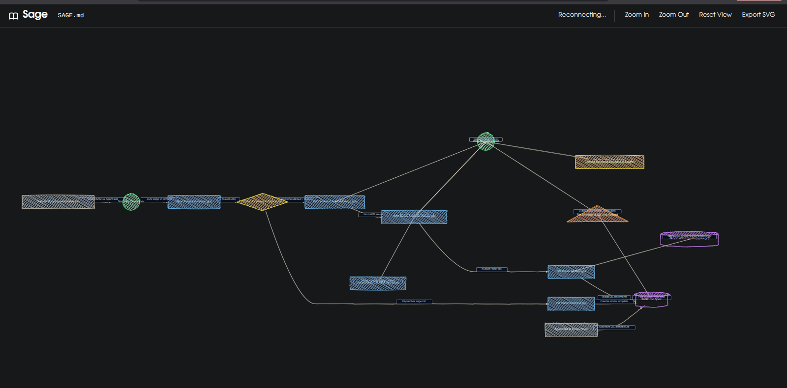

<p align="center">
  
</p>

<h1 align="center">Kill Technical Debt With A Map of Your Codebase</h1>

<p align="center">
  <strong>When your codebase is a mess, let the Sage show you how everything connects with Perfect Clarity.</strong>
</p>

<p align="center">
  <a href="#installation"></a>
  <a href="LICENSE"></a>
  <a href="https://github.com/diamondosas/sage/stargazers"></a>
</p>
[](https://skills.sh/diamondosas/sage)


---


> [!IMPORTANT]
> ### 📸 PLACEHOLDER: Visual Proof (Demo Video / GIF / Screenshot)
> *Drop your demo recording or high-res UI snapshot here to showcase Sage in action.*
> 
> ```markdown
> 
> ```
> *Recommended: 10-15s GIF showing `sage init` -> AI agent updating `SAGE.md` -> `sage ui` launching the interactive architecture canvas.*

---

## Install

Install Sage and instantly equip all your terminals and AI agents (Universal Agent Skills, Claude Code, Cursor):

### Option 1: Quick Shell Install (All Terminals)

```bash
curl -fsSL https://raw.githubusercontent.com/diamondosas/sage/main/assets/install.sh | sh
```

### Option 2: via NPX / Node.js

```bash
npx sage-codebase
```

### What this installs automatically:
- **Sage CLI** binary (`sage`) placed in your `$PATH` (`/usr/local/bin` or `~/.local/bin`)
- **Universal Agent Skill** installed to `~/.agents/skills/sage`
- **Claude Code Skill** installed to `~/.claude/skills/sage`
- **Cursor AI Skill** installed to `~/.cursor/skills/sage`
- **Local Workspace Skill** linked to `./.agents/skills/sage` if inside a git repository

---

## How it Works

### 1. Initialize Architecture Spec
Generate a starter `SAGE.md` map for your repository:
```bash
sage init
```

### 2. Let Your AI Agent Maintain the Map
AI agents (Claude Code, Cursor, Codex, OpenCode) use the embedded `sage` skill to surgically map modules, dependencies, and hotspots without full-file churn.

### 3. Launch the Interactive Visualizer
Explore your architecture in an Excalidraw-style interactive canvas:
```bash
sage ui
```
Opens `http://127.0.0.1:8080` in your browser.

---

> [!NOTE]
> ## HIGHLIGHTED SECTIONS TO ADD
> *These recommended sections will help onboard contributors and enterprise adopters:*

### [Suggested Add] How It Works: The `SAGE.md` Spec
> [!TIP]
> **Highlight for users:** Show how easy `SAGE.md` syntax is:
> ```sage
> // group: Core Engine
> // path: internal/engine
> rect parser "AST Parser" [blue]
> cylinder db "Graph Store" [purple]
> parser -> db "Persists topology"
> ```


---

<!-- ## 📈 Star History

[](https://star-history.com/#diamondosas/sage&Date) -->

---

## 📄 License

[MIT](LICENSE) © [diamondosas](https://github.com/diamondosas)