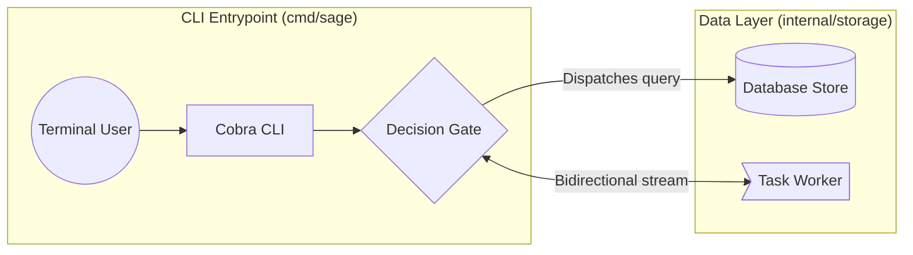

# Sage Skill: Architecture Mapping

Map codebase architecture into `SAGE.md` so human users can visually inspect structure and technical debt in the `sage` browser UI.

## Mission & Rules
1. **Never guess**: Don't assume facts about the codebase. Do not invent file paths, dependencies, or patterns if unsure. Check git status or directory trees first.
2. **Concise explanations**: Keep commentary minimal and focused on structure.
3. **Reference documentation**: See [references/language-syntax.md](references/language-syntax.md) for full syntax, shapes, and color rules.

## SAGE.md Syntax Quick Reference
Architecture maps in `SAGE.md` are specified using standard Mermaid `flowchart LR` (or `flowchart TD`) code blocks:

## Incremental Update Protocol
When code changes after `SAGE.md` exists:
1. **Never regenerate the whole file.**
2. Run `git status` and `git diff` to locate modified files and packages.
3. Locate corresponding `// group:` or node IDs in `SAGE.md`.
4. Surgically update or append only the touched nodes and connections.
5. Remind the user to run `sage ui` in their terminal to view the interactive diagram. If `sage` is not installed on their system, tell them to install it via:
   `curl -fsSL https://raw.githubusercontent.com/diamondosas/sage/main/assets/install.sh | sh` (or `npx sage-codebase`).
