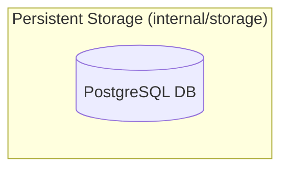
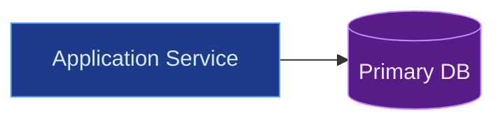
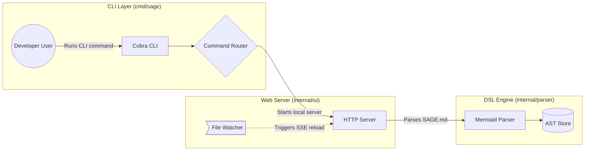

# SAGE Architecture Language Specification (`language-syntax.md`)

The standard syntax for `SAGE.md` is standard Mermaid `flowchart LR` (or `flowchart TD`) markup. AI coding agents use this specification to generate and incrementally maintain codebase architecture diagrams rendered by the `sage` visualizer.

---

## 1. Golden Rule: No Assumptions
> **CRITICAL**: The AI must never assume facts about the codebase. Every node, arrow, subgraph, and file path must be verified against actual repository files, imports, and `git status`/`git diff`. Never speculate or invent phantom modules.

---

## 2. File Format & Code Fences
An architecture diagram file (`SAGE.md`) encloses Mermaid markup within a standard ```` ```mermaid ```` block:

````markdown
# Architecture Map

```mermaid
flowchart LR
    %% CHANGE DIRECTION: Replace "LR" with "TD" to render a vertical top-to-bottom layout
    %% Architecture diagram definitions go here
```
````

*(Note: Sage also provides seamless backward compatibility for legacy ```` ```sage ```` blocks via automatic on-the-fly transpilation).*

---

## 3. Subgraphs (Codebase Directory Clustering)
Group related components into architectural subgraphs that map directly to codebase folders or domains:



- **ID**: Clean alphanumeric identifier without spaces (e.g., `CLI`, `Storage`, `Frontend`).
- **Bracket Title**: Human-readable label enclosed in quotes with verified directory path: `["Domain Name (path/to/dir)"]`.

---

## 4. Component Shapes Cheat Sheet
Define architectural nodes using standard Mermaid geometric delimiters:

| Component Type | Mermaid Syntax | Delimiter | Semantic Role |
| :--- | :--- | :--- | :--- |
| **Service / Module** | `service["API Service"]` | `["..."]` | Core services, packages, HTTP handlers, controllers |
| **User / Consumer** | `user(("Web Browser"))` | `(("..."))` | Terminal developers, human users, external clients |
| **Decision / Gateway** | `auth{"Auth Gate"}` | `{"..."}` | Routers, API gateways, decision points, evaluators |
| **Worker / Queue** | `worker>"Worker Queue"]` | `nodeID>"..."]` | Background jobs, queue consumers, async event handlers |
| **Database / Store** | `db[("Main Database")]` | `[("...")]` | Persistent databases, file systems, disk caches |

*(Comment actionable variable: To change a component's rendered geometry, switch the delimiter pair, e.g. change `["..."]` to `[("...")]` to convert a module into a database).*

---

## 5. Palette Color Classes
Sage visualizer comes pre-calibrated with 7 dark-slate architectural color classes. Attach color styling to any node using the `:::<color>` class tag:

- `:::blue` - Core services, application packages, and controllers.
- `:::green` - Entrypoints, human users, clients, and healthy interfaces.
- `:::yellow` - Decision gates, auth verifiers, and command dispatchers.
- `:::purple` - Persistent storage, databases, and graph AST models.
- `:::orange` - Background workers, file watchers, and asynchronous queue consumers.
- `:::red` - External untrusted APIs, error boundaries, and monitor alerts.
- `:::gray` - Shared utilities, helper libraries, and neutral fallback modules.

### Optional classDef Declarations
The Sage Sketchify engine automatically provides hand-drawn fills and borders for these classes. You may include standard class definitions at the bottom of the diagram for standard Mermaid previewers:



---

## 6. Dependency Arrows & Connections
Connect components with explicit dependency edges and clear action descriptions:

- **Directed Call / Dependency**:
  `source --> target` or `source -->|"Action / Protocol"| target`
- **Bidirectional Synchronization**:
  `source <--> target` or `source <-->|"Two-way Sync / Stream"| target`
- **Asynchronous / Weak Reference**:
  `source -.-> target` or `source -.->|"PubSub Event"| target`

*(Comment actionable variable: Switch arrow head from `-->` to `<-->` to represent two-way streaming or bidirectional communication instead of one-way request/response).*

---

## 7. Incremental Maintenance Protocol for AI Agents
When modifying or updating an existing architecture diagram:
1. **Never wipe or regenerate the entire file**: AI models must respect established diagrams and perform minimal, surgical diffs.
2. **Localize changes**:
   - Run `git status` and `git diff` to identify touched modules.
   - Find the existing `subgraph` corresponding to the touched codebase path.
   - Surgically add or update only the affected nodes and connection arrows.
3. **Preserve surrounding context**: Retain existing nodes, connections, and subgraph layouts for untouched modules.
4. **Explain simply**: Write component labels and edge descriptions as if teaching a child—straightforward, concise, and focused on structure.

---

## 8. Complete Working Example


